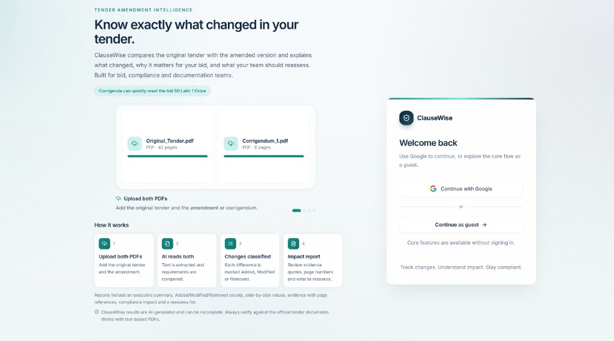
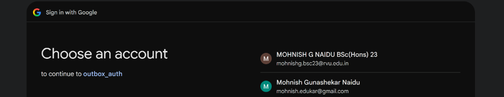
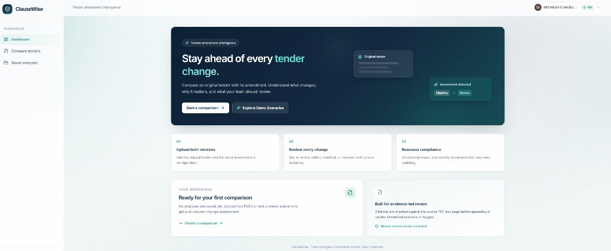
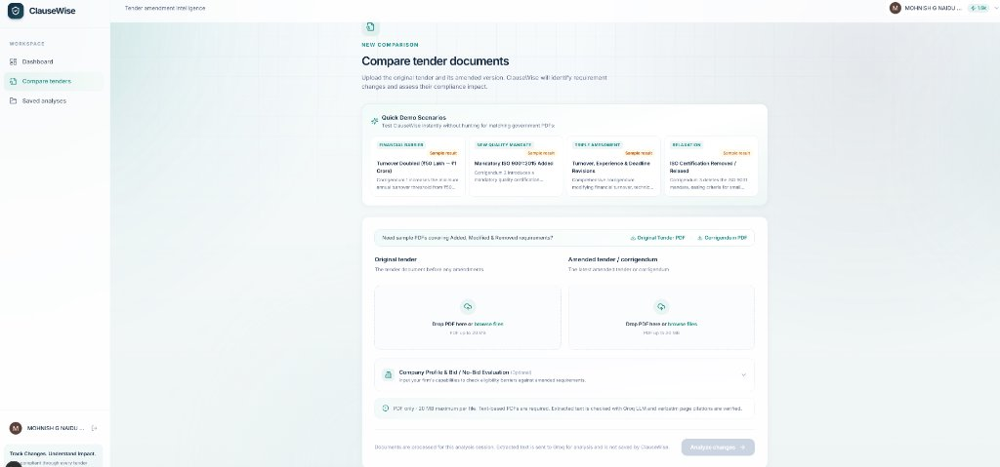
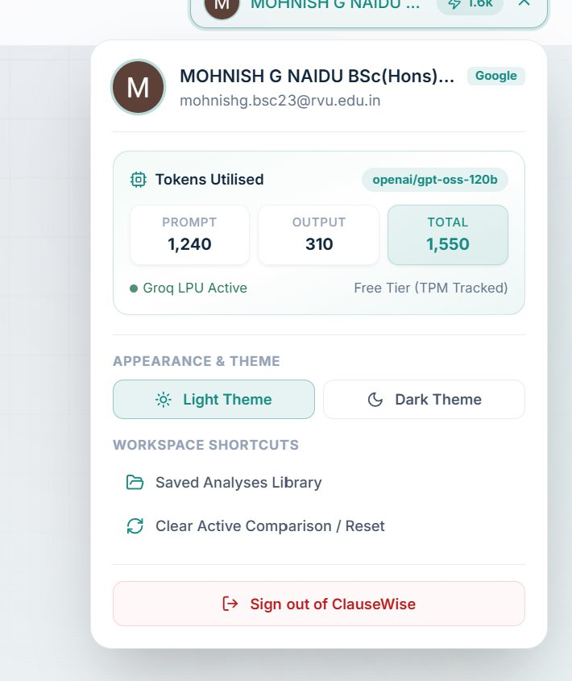
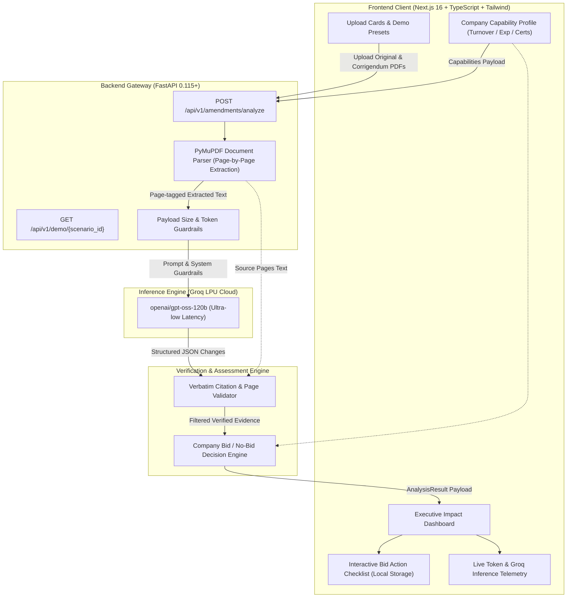

# ClauseWise

<div align="center">


**AI-Powered Tender Amendment Analysis and Compliance Impact Assessment**

*Track Changes. Understand Impact. Stay Compliant.*

[](https://fastapi.tiangolo.com)
[](https://nextjs.org)
[](https://groq.com)
[](https://pymupdf.readthedocs.io/)
[](https://www.typescriptlang.org)
[](https://tailwindcss.com)
[](LICENSE)

</div>

---

## 📌 Executive Overview

When government departments issue tenders, subsequent **corrigenda** or **amendments** regularly introduce critical revisions to eligibility thresholds, technical qualifications, and submission deadlines.

Manual PDF comparison tools fail for public procurement because they focus on **textual diffs** (highlighting changed words) rather than **procurement semantics**:
* *Textual diff*: Flags that `₹50 Lakh` changed to `₹1 Crore`.
* **ClauseWise Intelligence**: Interprets that the **minimum financial eligibility threshold has doubled**, flags bidders falling between ₹50 Lakh and ₹1 Crore as **ineligible sole bidders**, advises consortium formation, and generates a formal **Pre-Bid Clarification Request letter**.

ClauseWise combines high-throughput document extraction (**PyMuPDF**), large language model reasoning on **Groq LPU hardware** (`openai/gpt-oss-120b`), verbatim quote-verification guardrails, and a company eligibility decision engine.

---

## 🖼️ Visual Walkthrough & Product Interface

### 1. Unified Authentication & Instant Guest Access
ClauseWise provides dual-mode access: users can sign in using **Google OAuth 2.0** for identity display and session persistence, or click **Continue as guest** to access all comparison tools without creating an account.

<div align="center">
  
  <p><em>Figure 1: Authentication screen featuring Google OAuth and instant guest access.</em></p>
</div>

---

### 2. Google OAuth 2.0 Identity Provider Flow
Seamless single sign-on powered by **NextAuth.js v5**, automatically extracting user profile details (avatar, name, work email) to personalize the bidding workspace.

<div align="center">
  
  <p><em>Figure 2: Verified Google OAuth consent screen connecting bidder credentials.</em></p>
</div>

---

### 3. Executive Intelligence Dashboard
Upon entry, the dashboard gives bid and compliance teams an immediate overview of active comparisons, recent analyses with eligibility verdicts, and a 3-step walkthrough of the corrigendum assessment pipeline.

<div align="center">
  
  <p><em>Figure 3: Main dashboard displaying user profile, active token usage badge, and workflow steps.</em></p>
</div>

---

### 4. Tender Comparison Workspace & Test Harness
The workspace allows users to upload original tenders and corrigenda side by side via drag-and-drop. It includes:
* **Direct Sample PDF Downloads**: One-click download links for test tenders covering Modified, Added, and Removed requirements.
* **Quick Demo Presets**: Four pre-packaged scenarios (Turnover Doubled, ISO Added, Triple Amendment, ISO Removed) for rapid demonstration.
* **Company Profile Drawer**: Input annual turnover, experience years, and certifications for instant Bid / No-Bid evaluation.

<div align="center">
  
  <p><em>Figure 4: Workspace form with sample tender links, demo scenarios, upload cards, and company profile input.</em></p>
</div>

---

### 5. Live Groq Token Telemetry & Theme Switcher
Clicking the user avatar opens an interactive telemetry dropdown showing real-time inference metrics:
* **Token Breakdown**: Prompt Tokens (`1,240`), Output Tokens (`310`), and Total Tokens (`1,550`).
* **Active Hardware**: Groq Cloud LPU acceleration with model `openai/gpt-oss-120b`.
* **Appearance Preferences**: 1-click **Light Theme** ☀️ and **Dark Theme** 🌙 toggles with local storage persistence.
* **Workspace Shortcuts**: Quick links to the Saved Analyses library and cache reset.

<div align="center">
  
  <p><em>Figure 5: Header settings dropdown displaying live token consumption and theme toggles.</em></p>
</div>

---

## 🏗️ System Architecture



---

## 🚀 Key Capabilities

### 1. Procurement Requirement-Level Comparison
* **Added Requirements**: Newly introduced conditions (e.g., mandatory ISO 9001:2015 certification) flagged with required documentation.
* **Modified Requirements**: Altered qualification bars (e.g., turnover doubled from ₹50 Lakh to ₹1 Crore, experience increased from 3 to 5 years, deadline extension).
* **Removed Requirements**: Withdrawn conditions (e.g., deleted environmental management mandate) flagged for verification.

### 2. Company Profile & Bid / No-Bid Decision Engine
* Evaluate your firm's **Annual Turnover**, **Years of Experience**, and **Certifications** directly against amended requirements.
* Generates clear verdicts:
  * 🟢 **Bid Recommended · Eligible**: All criteria satisfied.
  * 🟡 **Conditional Bid · Action Required**: Quantitative conditions met; specific clauses require review.
  * 🔴 **No-Bid Warning · Critical Barrier**: Disqualification barrier detected (suggests Joint Venture or Consortium remedies).

### 3. Evidence-Led Verification Guardrails
* Every citation quoted by the LLM is checked against the raw PyMuPDF page text.
* Unverified quotes or hallucinations are omitted from citations and flagged under model warnings.

### 4. Interactive Bid Preparation Checklist
* Tasks dynamically derived from the corrigendum (e.g., Bank Guarantee validity extension, CA turnover re-certification).
* Automatically starts **0 / N completed (unchecked)** on new runs.
* Persistent state keyed to each analysis in browser storage.

### 5. Pre-Bid Clarification Query Draft Generator
* 1-click generator on every change card produces formal correspondence addressed to the Tendering Authority requesting relief or clarification.

### 6. Live Token & Telemetry Dashboard
* Real-time visibility into **Prompt Tokens**, **Completion Tokens**, **Total Tokens**, and inference model status in the header account menu.
* **Dark & Light Mode** instant theme switcher.

---

## 🧪 Testing with Sample Documents

We have generated official test tender PDF pairs covering all three change categories (Added, Modified, Removed).

### 📥 Sample Tender Files
You can find them in [`sample_documents/`](./sample_documents/) or download them directly from the running web app:

| Document | Local File Link | Direct Browser Download Link | Test Scenarios Covered |
|---|---|---|---|
| **Original Tender** | [`Original_Tender_NIT_2026_PWD.pdf`](./sample_documents/Original_Tender_NIT_2026_PWD.pdf)<br>[Download from Web Server](http://localhost:3000/samples/Original_Tender_NIT_2026_PWD.pdf) | • Turnover: ₹50 Lakh<br>• Experience: 3 Years<br>• Mandatory ISO 14001<br>• Bid Deadline: 15 Dec 2026 |
| **Corrigendum 01** | [`Corrigendum_01_Amendments.pdf`](./sample_documents/Corrigendum_01_Amendments.pdf)<br>[Download from Web Server](http://localhost:3000/samples/Corrigendum_01_Amendments.pdf) | • Turnover: **₹1 Crore** *(Modified)*<br>• Experience: **5 Years** *(Modified)*<br>• ISO 9001:2015: **Mandatory** *(Added)*<br>• ISO 14001: **Deleted** *(Removed)*<br>• Bid Deadline: **20 Dec 2026** *(Extended)* |

### How to Run the Test:
1. Open **[http://localhost:3000/workspace](http://localhost:3000/workspace)**.
2. Drag & drop `Original_Tender_NIT_2026_PWD.pdf` into **Original tender**.
3. Drag & drop `Corrigendum_01_Amendments.pdf` into **Amended tender / corrigendum**.
4. *(Optional)* Expand **Company Profile & Bid / No-Bid Evaluation** and enter:
   * Turnover: `₹75 Lakh`
   * Experience: `4`
   * Certifications: `ISO 9001:2015`
5. Click **Analyze changes**.
6. **Result**:
   * **Bid Verdict**: 🔴 *No-Bid Warning · Critical Barrier* (Company's ₹75 Lakh turnover is below the revised ₹1 Crore threshold).
   * **Changes Identified**: 3 Modified, 1 Added, 1 Removed.
   * **Telemetry**: View token usage in the top-right header menu.

---

## 📦 Project Layout

```text
ClauseWise/
├── backend/
│   ├── app/
│   │   ├── main.py                     # FastAPI routes & middleware
│   │   ├── models.py                   # Pydantic schemas (AnalysisResult, GroqUsage, Profile)
│   │   └── services/
│   │       ├── analyzer.py             # Groq LLM integration, error mapping, verification
│   │       ├── demo_data.py            # Pre-configured procurement scenarios
│   │       └── pdf.py                  # PyMuPDF text & page extractor
│   ├── tests/
│   │   ├── test_api.py                 # Endpoint tests (429, 413, 503, 502, usage)
│   │   └── test_evidence.py            # Evidence quote verification tests
│   ├── generate_sample_pdfs.py         # PyMuPDF test tender generator
│   ├── requirements.txt
│   └── .env.example
├── docs/
│   └── screenshots/                    # High-resolution application screenshots
│       ├── 01_login_oauth.jpg
│       ├── 02_google_auth_flow.png
│       ├── 03_dashboard.jpg
│       ├── 04_workspace_upload.jpg
│       └── 05_telemetry_and_settings.jpg
├── frontend/
│   ├── src/
│   │   ├── app/
│   │   │   ├── (app)/
│   │   │   │   ├── page.tsx            # Dashboard with recent analyses
│   │   │   │   ├── workspace/page.tsx  # Document upload & preset selector
│   │   │   │   ├── results/page.tsx    # Impact assessment report & checklist
│   │   │   │   └── saved/page.tsx      # Saved analyses library
│   │   │   ├── login/page.tsx          # Google OAuth sign-in screen
│   │   │   └── layout.tsx              # Root NextAuth & theme provider
│   │   ├── components/
│   │   │   ├── header-account.tsx      # Telemetry popover & theme switcher
│   │   │   ├── workspace-form.tsx      # Upload form & loading stepper
│   │   │   └── sidebar.tsx             # Navigation & saved counter
│   │   └── lib/
│   │       ├── api.ts                  # Backend API client
│   │       ├── demo-data.ts            # Client fallback demo data
│   │       ├── export.ts               # Excel/CSV spreadsheet exporter
│   │       └── saved-store.ts          # LocalStorage saved analysis repository
│   ├── public/
│   │   ├── samples/                    # Direct downloadable test tender PDFs
│   │   └── screenshots/                # Public screenshot assets
│   ├── package.json
│   └── tailwind.config.ts
├── sample_documents/                   # Sample tender test files
└── README.md
```

---

## ⚡ Quick Start

### 1. Prerequisites
* **Node.js**: `v20.9+`
* **Python**: `3.10+` (Python 3.13 tested)
* **Groq API Key**: Free tier available at [console.groq.com](https://console.groq.com)

### 2. Backend Setup

```bash
cd backend

# Create virtual environment
python -m venv .venv
source .venv/bin/activate       # Windows: .venv\Scripts\activate

# Install dependencies
pip install -r requirements.txt

# Configure environment
cp .env.example .env
```

Edit `backend/.env` with your API key:
```env
GROQ_API_KEY=gsk_your_groq_api_key_here
GROQ_MODEL=openai/gpt-oss-120b
FRONTEND_ORIGINS=http://localhost:3000
MAX_UPLOAD_SIZE_MB=20
MAX_COMBINED_TEXT_CHARS=180000
```

Start the backend API server:
```bash
uvicorn app.main:app --host 127.0.0.1 --port 8000 --reload
```
API docs available at **`http://localhost:8000/docs`**.

### 3. Frontend Setup

In a new terminal:
```bash
cd frontend

# Install dependencies
npm install

# Start Next.js development server
npm run dev
```

Open **`http://localhost:3000`** in your browser.

*(Optional)* To enable Google OAuth login, configure `frontend/.env.local`:
```env
GOOGLE_CLIENT_ID=your-client-id.apps.googleusercontent.com
GOOGLE_CLIENT_SECRET=your-client-secret
NEXTAUTH_SECRET=generate-via-openssl-rand-base64-32
NEXTAUTH_URL=http://localhost:3000
```

---

## 🌐 Production Deployment Guide

ClauseWise is pre-configured for seamless production hosting:

### 1. Deploy Frontend on Vercel
1. Push your repository to GitHub: [`https://github.com/Mohnish-140605/GenAI_Clausewise`](https://github.com/Mohnish-140605/GenAI_Clausewise).
2. Go to [vercel.com](https://vercel.com) and click **"Add New Project"**.
3. Import `GenAI_Clausewise` and set:
   * **Root Directory**: `frontend`
   * **Framework Preset**: `Next.js`
4. Add the following **Environment Variables** in Vercel:
   * `NEXT_PUBLIC_API_BASE_URL`: URL of your deployed backend (e.g., `https://clausewise-api.onrender.com`)
   * `NEXTAUTH_URL`: Your Vercel domain (e.g., `https://genai-clausewise.vercel.app`)
   * `NEXTAUTH_SECRET`: Random 32-byte secret (`openssl rand -base64 32`)
   * `GOOGLE_CLIENT_ID`: Your Google OAuth Client ID
   * `GOOGLE_CLIENT_SECRET`: Your Google OAuth Client Secret
5. Click **Deploy**.

---

### 2. Deploy Backend on Render or Railway
* **Option A: Render Blueprint (1-Click)**
  1. Go to [render.com](https://render.com) → **New** → **Blueprint**.
  2. Connect your repo `Mohnish-140605/GenAI_Clausewise`. Render will automatically detect `render.yaml`.
  3. Enter your `GROQ_API_KEY` when prompted and click **Apply**.
* **Option B: Docker / Container Deployment**
  A production `backend/Dockerfile` and `backend/Procfile` are included in the repository. Set the container port to `8000`.

---

## 🔑 Google Cloud Console OAuth Configuration Guide

When running locally or deploying to production, configure your Google OAuth 2.0 Client credentials:

1. Open [Google Cloud Console](https://console.cloud.google.com).
2. Navigate to **APIs & Services** → **Credentials**.
3. Click your **OAuth 2.0 Client ID** (under *Web application*).
4. Scroll down to:

### A. Authorized JavaScript Origins
Add both your local dev URL and production domain:
* `http://localhost:3000` *(Local development)*
* `https://genai-clausewise.vercel.app` *(Your production domain without trailing slash)*

### B. Authorized Redirect URIs
NextAuth requires the `/api/auth/callback/google` route:
* `http://localhost:3000/api/auth/callback/google` *(Local development)*
* `https://genai-clausewise.vercel.app/api/auth/callback/google` *(Your production callback URL)*

5. Click **Save**. Updates typically take 1–2 minutes to propagate across Google's edge servers.

---

## 📊 Groq Usage & Rate Limits

ClauseWise is optimized for high efficiency:
* **Single LLM Call**: Each document comparison requires exactly **one call** to Groq's chat completions API (`openai/gpt-oss-120b`).
* **Telemetry**: Prompt tokens, output tokens, and total tokens are logged by the backend and displayed live in the frontend dropdown.
* **Error Handling**:
  * `429`: Rate limit reached; passes through upstream `Retry-After` seconds.
  * `413`: Token-per-minute (TPM) limit exceeded; advises shorter PDFs or upgrading.
  * `503`: Groq configuration or authentication error.
* **Character Limit**: Controlled by `MAX_COMBINED_TEXT_CHARS` (default: 180,000 chars combined text).

---

## 🧪 Verification & Test Suite

### Backend Pytest Suite
Run the 12 automated unit and integration tests:
```bash
cd backend
pytest -v
```
```text
tests/test_api.py::test_analyze_rejects_non_pdf_extension PASSED
tests/test_api.py::test_analyze_rejects_invalid_pdf_content PASSED
tests/test_api.py::test_analyze_reports_missing_groq_configuration PASSED
tests/test_api.py::test_demo_scenario_turnover_returns_valid_data PASSED
tests/test_api.py::test_demo_scenario_evaluates_company_profile PASSED
tests/test_api.py::test_groq_rate_limit_returns_429 PASSED
tests/test_api.py::test_groq_auth_error_returns_503 PASSED
tests/test_api.py::test_groq_413_returns_413 PASSED
tests/test_api.py::test_groq_tpm_exceeded_in_body_returns_413 PASSED
tests/test_api.py::test_groq_other_error_returns_502 PASSED
tests/test_api.py::test_groq_successful_response_includes_usage PASSED
tests/test_evidence.py::test_evidence_is_verified_against_its_document_and_page PASSED

======================= 12 passed in 5.54s =======================
```

### Frontend Typecheck & Lint
```bash
cd frontend
npm run lint       # 0 errors, 0 warnings
npm run build      # Compiles all 7 static routes
```

---

## 🔒 Security & Data Privacy

* **Ephemeral Processing**: Tender PDFs are processed in memory during the analysis session. Documents are never stored in a persistent database.
* **Citation Grounding**: Source evidence is strictly matched against PyMuPDF page text.
* **Secrets Management**: `.env` and `.env.local` files are git-ignored. No credentials or API keys are ever committed to version control.

---

## 📄 License

This project is licensed under the MIT License — see the [LICENSE](LICENSE) file for details.
